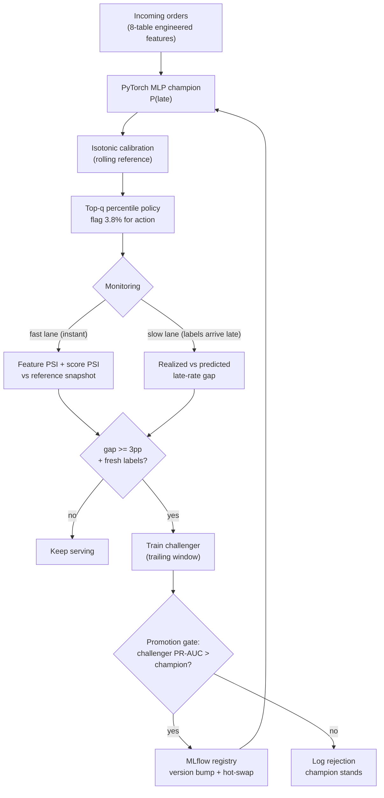

# ml-reliability

End-to-end production ML pipeline — drift monitoring, drift-triggered retraining, and champion/challenger promotion via MLflow. A delivery-delay risk model that detects when the world changes and re-heals itself. No human in the loop.

[](https://github.com/arponbiswasanik/ml-reliability/actions/workflows/ci.yml)


---

## Why This Exists

ML models degrade in production — not because the code breaks, but because the world moves. This project is a complete, working answer to that problem, built on 100K real e-commerce orders (Olist, Brazilian marketplace, 2016–2018):

- **Champion model** — a PyTorch MLP predicting the probability a delivery promise will be broken, from 25 engineered features built by joining 8 relational tables
- **Two-tier drift monitoring** — fast lane (feature/score PSI, instant) + slow lane (realized-vs-predicted label gap, arrives with delivery outcomes)
- **Self-healing loop** — drift alarm → retrain challenger → promotion gate (challenger must beat champion) → MLflow registry version bump → hot-swap
- **Serving** — FastAPI with the drift tripwire built into the batch endpoint; Dockerized; CI-gated

The demonstration: Olist's late-delivery rate swings from 1.4% to 21.4% across the dataset's lifetime. When the August 2018 spike hit, the monitor alarmed at a +11.7pp label gap, the loop retrained, the challenger lifted PR-AUC 0.117 → 0.369, and was auto-promoted. One promotion, zero humans.

This project is also the deliberate sequel to [ticket-triage](https://github.com/arponbiswasanik/ticket-triage), where I measured prevalence drift (20.9% → 16.3%) and documented "production answer: rolling recalibration" as a limitation. This repo builds the remedy.

---

## Headline Results

| Result | Value |
|--------|-------|
| Model comparison (4 families) | PyTorch MLP wins: ROC 0.814 / PR 0.169 (5.05× lift) |
| Calibration (isotonic) | ECE 0.198 → 0.003 |
| Natural drift detected | late rate 1.4% → 21.4% monthly swing, chronic + acute features |
| Self-healing event | alarm +11.7pp → PR-AUC 0.117 → 0.369 (3.2×) → auto-promoted |
| Policy economics (calm window) | +9.3% cost saved at $1 intervention tier |
| API drift tripwire | shifted batch: alarms on exactly the injected features, mean risk 2.59× |
| Reproducibility | container predictions bit-identical to local; CI green in ~1 min |

---

## Architecture



Two lanes because labels lag. Deliveries complete days-to-weeks after purchase, so the fast lane (label-free PSI) watches feature and score distributions instantly, while the slow lane compares realized vs predicted late rates once outcomes arrive. The August event was caught by the slow lane — see the finding below for why that matters.

---

## Data: 8 Tables, One Label, Three Structural Guards

Olist Brazilian E-commerce dataset — 99,441 orders, 2016-09 → 2018-10, schema verified fail-loud (script 01).

**Label:** `is_late = delivered_date > estimated_delivery_date` — predict at purchase time whether the delivery promise breaks. 93,906 labeled orders after three documented guards:

- **Leakage quarantine** — post-purchase fields (approval, carrier/customer delivery dates, reviews) are never features; the estimated date is known at purchase and is legitimately a feature
- **Censoring guard** — final-14-day purchases dropped (snapshot may cut outcomes)
- **Dedup + 2016 fragment** — 272 pre-2017 rows dropped (ingest gap); invalid-date check (0 found, but tested)

Splits are temporal, not random: train 75,124 (Jan 2017 → May 2018) / test 9,390 (May → Jul 2018) / stream 9,392 (Jul → Aug 2018). An 80/10/10 row split would leak the future into training. The test window landed on a low-prevalence stretch (3.3% vs 8.8% train) — documented, not re-rolled: choosing test boundaries after seeing the late curve is test-set gaming.

**Feature engineering** (script 03): seller↔customer haversine distance (median-of-zip geolocation, 42 out-of-Brazil coordinates filtered), point-in-time seller history (expanding late-rate with the current order excluded — seller track record is the strongest signal: late rate 5.5% → 12.3% across its quintiles), freight ratio, item/dimension aggregations, temporal features, train-only median fills (2,807 new-seller rows → global prior).

---

## Model Selection: The MLP That Beat the Trees

Four candidates, one protocol: train on TRAIN, select on TEST, report once. Test prevalence 3.3%, so PR-AUC and lift over base rate are the honest metrics.

| Model | ROC-AUC | PR-AUC | Lift | Fit time |
|-------|---------|--------|------|----------|
| LogReg (one-hot + scaled) | 0.804 | 0.117 | 3.50× | 1.1 s |
| Random Forest | 0.740 | 0.099 | 2.96× | 10.9 s |
| PyTorch MLP (128-64, dropout, pos-weighted) | 0.814 | 0.169 | 5.05× | 5.2 s |
| LightGBM | 0.760 | 0.111 | 3.31× | 1.5 s |

The trees lost — and the why is documented, not hidden. The one-hot encoding suited the linear model and the network, but handicapped the trees (many sequential splits needed to reconstruct a single category's effect, `colsample_bytree` often can't chain them). The honest follow-up — LightGBM with native categorical codes — is future work, not a post-hoc re-run after seeing test results. The feature `est_window_days` already predicted this: its relation to lateness is U-shaped (17–22 day promises are the danger zone), which trees should dominate — the encoding blocked them.

The champion ships as a PyTorch model served in production: benchmarked, selected on merit, and deployable — torch in the runtime image is the accepted cost.

---

## Calibration + The Policy That Had to Change

Isotonic calibration fitted on the train tail (Feb–May 2018), evaluated once on test:

| | ECE ↓ | Brier ↓ |
|---|-------|---------|
| Raw MLP | 0.198 | 0.0868 |
| + isotonic | 0.003 | 0.0316 |

Then the economics bit back, and the policy evolved — with receipts. The action threshold came from cost arithmetic: expedite when P(late) > C_upgrade/C_late = 8/45 = 0.178.

| Policy (same test window, 3.3% prevalence) | Flags | Precision | Cost vs do-nothing |
|--------------------------------------------|-------|-----------|--------------------|
| v1: absolute threshold @ $8 | 45 (0.5%) | 15.6% | −0.02% (inert) |
| v2: top-3.8% percentile @ $8 | 358 | 10.6% | −6.6% |
| v2: top-3.8% @ $1 watch-list tier | 358 | 10.6% | +9.3% |

Three documented findings: (1) absolute thresholds starve under prevalence shift — calibration fitted on a 6.4% world goes nearly silent in a 3.3% one; (2) percentile rules survive shift by construction — the deployed policy became "flag top q% of each batch"; (3) the intervention's cost structure decides profitability, not the model — same flags flip from −6.6% to +9.3% when the intervention is a $1 watch-list action instead of an $8 physical expedite. Break-even flag precision: 18.6% at $8, 2.3% at $1.

---

## Drift Monitoring: Two Lanes, One Subtle Catch

Hand-rolled PSI (transparent, ~25 lines, edge bins open, zero-count bins clipped) — the drift logic is the product; Evidently is credited in production notes as the scale-out tool. Reference = calibration slice; calendar features excluded from PSI (cyclical by construction → alarm fatigue).

**Stage A drift** — walking 14-day windows across test+stream:

| Window | Realized vs predicted | What it was |
|--------|-----------------------|-------------|
| May 16–30 | 9.8% vs 3.6% (+6.2pp ALARM) | train/test boundary artifact — regimes don't respect split dates |
| June | 1.6% vs 3.1% (−1.5pp) | over-prediction: calibrator anchored to a hotter world |
| Jul 25–Aug 8 | 12.1% vs 5.8% (+6.3pp ALARM) | the spike, caught |

**The subtle catch** — the project's most interesting finding: score PSI *fell* as the label gap grew (0.79 in May → 0.11 in August). August's input features looked like the reference (marketplace back to normal volumes) while the label-generating process (carriers, logistics capacity) had shifted: same-looking orders, more of them late. Concept drift wearing covariate drift's clothing — invisible to fast-lane PSI alone. The slow lane caught it. That asymmetry is why both lanes exist.

Also chronic: `est_window_days` PSI-alarms nearly everywhere — Olist tightened delivery-promise policy mid-2018. Real, persistent, documented; chronic vs acute drift behave differently and deserve different responses.

---

## The Self-Healing Loop

Monthly walk over the stream period with a rolling reference (last 60 days of labeled data — the frozen-calibrator sin of Stage A, fixed), drift-triggered retraining, and a promotion gate:

```
2018-07: realized 4.5% vs predicted 2.0% (gap +2.5pp) | quiet
2018-08: DRIFT ALARM (gap +11.7pp) -> retrained (PR 0.117 -> 0.369) -> PROMOTED, hot-swapped
```

What the loop does on alarm: trains a challenger on the trailing labeled window → validates it against the incumbent on a recent labeled window → if the challenger's PR-AUC wins, logs the run to MLflow (trigger, train rows, champion vs challenger metrics), writes a version to the model registry, and hot-swaps the serving model. If it loses, the rejection is logged and the champion stands — the gate must be allowed to say no.

The promotion recovered discriminative power, not just calibration: PR-AUC 0.369 on spike-period data ≈ 2.8× base rate, versus a champion at barely-better-than-chance. Honest scope note: the stream period is two months, so the loop exercised one promotion and zero rejections — the rejection branch is implemented and unit-pathed, but not branch-taken. A longer stream would show both.

---

## API + Serving

| Endpoint | Purpose |
|----------|---------|
| `GET /health` | model version, policy config, monitor feature count |
| `POST /v1/score` | calibrated risk for one order |
| `POST /v1/score/batch` | score a batch, apply top-q flagging, run the fast-lane drift tripwire |

The batch endpoint carries its own tripwire (PSI vs a reference snapshot) — the service that got burned by drift monitors itself. Verified live:

| Batch (100 real August orders) | Drift result | Mean risk |
|-------------------------------|--------------|-----------|
| As-is | 1 chronic alarm (mean_weight_g), 1 warn | 0.0588 |
| Distances ×2, seller late-rates inflated | chronic + exactly the three injected features | 0.1523 (2.59×) |

The surgical alarm list — injected features fire, nothing else changes — is the tripwire discriminating *what* changed, not just *that* something changed. (A smoke-test design lesson is also documented: a batch of identical orders is a degenerate distribution and alarms PSI by construction — real-data batches are the honest test.)

---

## CI

GitHub Actions on every push/PR: 5 PSI unit tests (identical distributions, shift detection, out-of-range edge bins, degenerate reference, threshold classification) + a seeded end-to-end training smoke test on synthetic data — 2 epochs, asserts valid probability output. Green in ~1 min.

---

## Reproducibility

Everything regenerates from raw data — the numbered scripts are the experiment log:

| Script | Purpose | ~Runtime |
|--------|---------|----------|
| 01 | Olist schema verification (fail-loud) | s |
| 02 | Labels + temporal splits + censoring guard | s |
| 03 | 8-table feature engineering (point-in-time seller history) | 2 min |
| 04 | 4-model comparison → champion | 30 s |
| 05 | Calibration + policy v1/v2 + economics | 10 s |
| 06 | Stage A drift walk (14-day windows) | 1 min |
| 07 | Self-healing loop + MLflow registry | 3 min |
| 08 | Reference snapshot for the API tripwire | s |
| 09 | API smoke test (real-data batches) | s |

Trained artifacts (`models/`, `mlflow.db`) are gitignored and regenerable via the chain above.

---

## Known Limitations

Each is a documented tradeoff, not an oversight:

- **Test window prevalence (3.3% vs 8.8% train)** — a consequence of refusing to game split boundaries; PR-AUC is reported as lift over base rate for exactly this reason
- **Champion ROC 0.743 in calibration step vs 0.814 in comparison** — the honest cost of carving the calibration slice from train (63,856 vs 75,124 rows)
- **Two-month stream** — one promotion exercised, zero rejections; documented above
- **Chronic `est_window_days` / `mean_weight_g` alarms** — real Olist policy and product-mix shifts; distinguished from acute drift, not silenced
- **`seller_prior_rate` label-latency approximation** — a seller's very-recent-past orders may still be in-flight at purchase time (standard for this dataset, documented in script 03)
- **Score-at-calibration vs score-at-healing** — the served champion's calibration is anchored to the August regime; a calm September would under-flag until the next rolling recalibration (the loop's own remedy)
- **PSI is hand-rolled** — deliberately transparent; Evidently for scale

---

## Production Notes

- Evidently (or a metrics store) for fleet-scale drift dashboards; MLflow registry aliases (`champion`) for promotion hygiene
- Retraining as a scheduled job (the loop script) — never API-triggered from serving
- LightGBM with native categorical encoding as a follow-up candidate; re-run the full comparison protocol, not a post-hoc patch
- Longer streams exercise the rejection branch; alert routing (PagerDuty-style) for slow-lane alarms
- Gray-zone flag band around the top-q cut for borderline orders

---

## Setup

**Serve the API** (requires locally generated artifacts — run the script chain first):

```bash
docker compose up --build
# then: http://localhost:8000/docs
```

**Full reproduction:**

```bash
python -m venv .venv && source .venv/bin/activate   # Windows: .venv\Scripts\activate
pip install -r requirements-dev.txt
# download Olist (link above) -> data/raw/olist_*.csv
python notebooks/01_check_schema.py
# ... run scripts in numbered order through 08
uvicorn src.api:app --port 8000
```

---

## Dataset & License

- **Data:** [Brazilian E-Commerce Public Dataset by Olist](https://www.kaggle.com/datasets/olistbr/brazilian-ecommerce) — public, ~100K orders, 2016–2018
- **Code:** MIT
